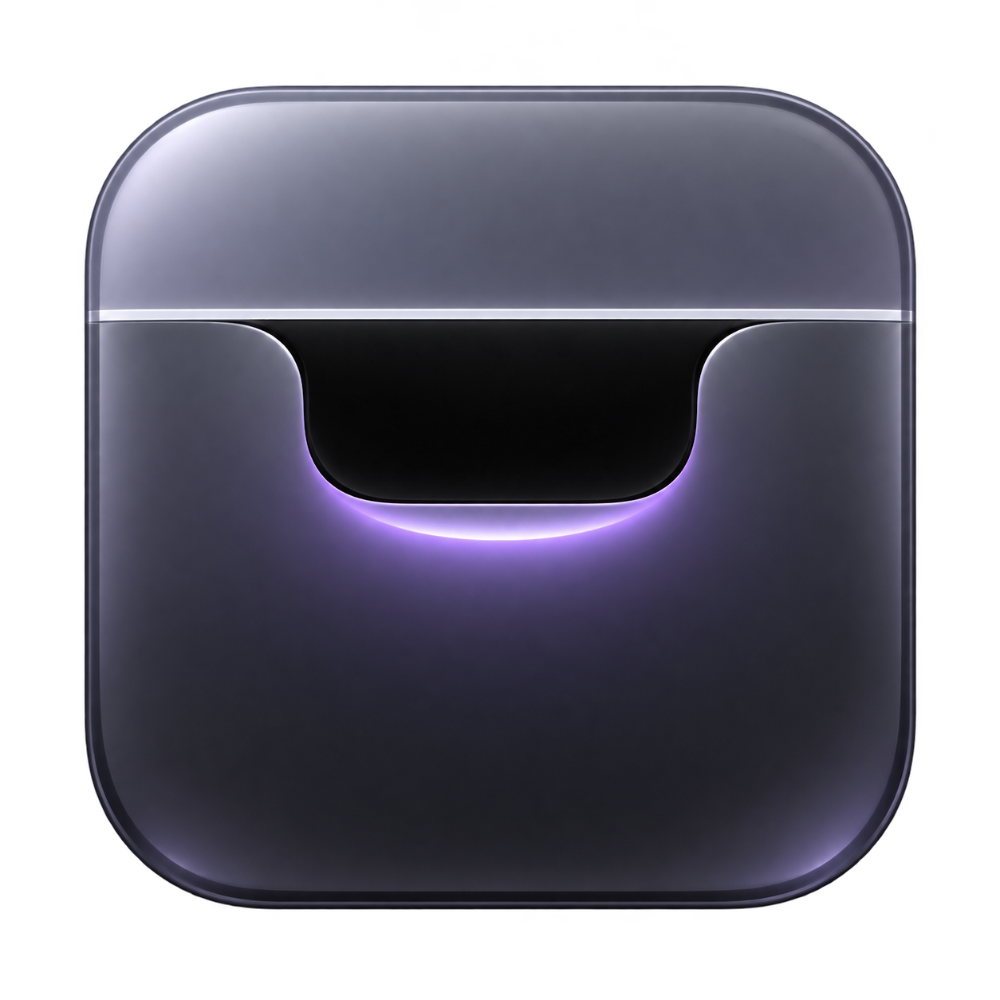
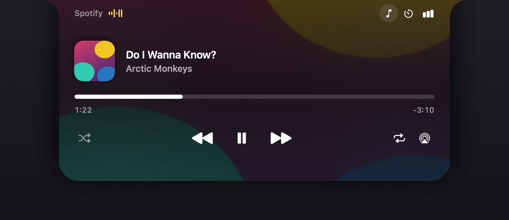
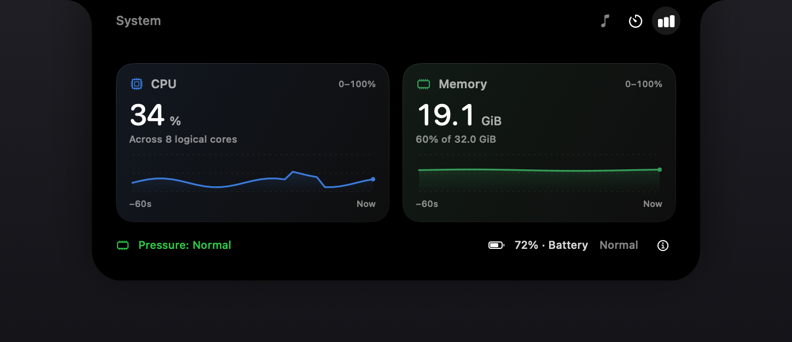
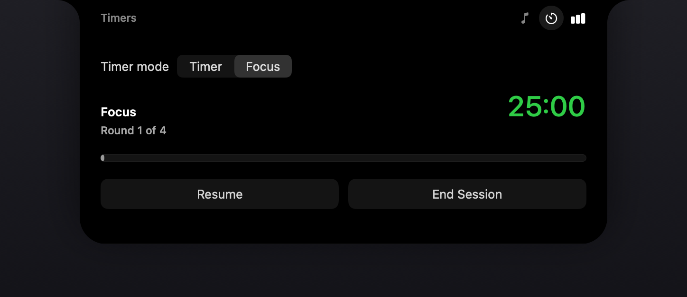

# Cornice



I wanted something like the iPhone's Dynamic Island on my Mac, so I started
Cornice. It sits around the notch and opens when you hover over it. I used
[Atoll](https://github.com/Atoll-Labs/Atoll) as inspiration, especially for how
opening the panel should feel.

The idea is to check your music, timers and system stats without opening another
window. I'm still working on it and polishing the parts that feel off.



## What it does

- Shows Apple Music and Spotify with the cover, song, artist and playback controls.
- Has six visualizer bars that follow captured audio. They stay still when the
  song is paused. With capture off, they only act as a playing indicator.
  New installs show them beside the notch without needing to hover.
- Uses the cover's colors for the background, including muted and grey artwork.
- Lets you pause, repeat and add time to a timer. Adding 25 minutes twice gives
  you one 50-minute timer. Save your own presets or turn on quiet completions.
- Has work and break sessions, starting with 25 minutes of work and a 5-minute
  break. You can change the lengths, rounds and whether the next phase starts
  by itself.
- Keeps timers and focus sessions when you quit or install an update.
- Shows CPU and memory readings with charts for the last minute, plus memory
  pressure, charging details and the battery condition reported by macOS.
- Checks for updates inside the app and lets you choose when to install them.
- Shows notices for charging, low battery, network and VPN changes, and wireless
  audio devices. Download notices can be enabled in Settings.

Hover only starts inside the notch's measured bounds. It gets measured again
when your display or scaling changes. You can also open the panel with **⌃⌥⌘D**
and switch between Music, Timers and System with **⌘1**, **⌘2** and **⌘3**.
Buttons support keyboard focus, and animations follow macOS Reduce Motion.




## Download

Get the DMG from the [latest release](https://github.com/Kirolosir/Cornice/releases/latest),
open it, and drag Cornice into Applications. The current installer includes the
app icon and is built for Apple silicon.

The app runs on macOS 14 or later. Audio capture needs macOS 14.2 or later.
It's mainly made for MacBooks with a notch. On a display without one, it uses a
small region in the middle of the menu bar.

The app is ad-hoc signed and isn't notarized, so macOS may block the first launch
or call it damaged. For this downloaded copy, you can remove the quarantine flag:

```bash
xattr -dr com.apple.quarantine /Applications/Cornice.app
```

Then try opening it again. Building it yourself is another option.

### Updating

Version 0.4.0 adds **Settings → Updates**, where you can see the installed version
and check for a new one. Automatic checks are optional. Cornice offers the update
and asks before installing and relaunching; keep the app in Applications so it can
replace its copy there.

The update feed and downloads are signed with an Ed25519 key. That update
signature is separate from Apple's signing and notarization, so the first-launch
steps above still apply to a fresh download.

If you're on 0.3.1 or older, download and install 0.4.0 once to get the updater.
Those older copies don't have an in-app update check.

## Build it yourself

Use Swift 6 with Xcode or the Command Line Tools to build the app. The first build
also downloads the Sparkle update framework.

```bash
git clone https://github.com/Kirolosir/Cornice.git
cd Cornice
make run
```

This builds `dist/Cornice.app` and opens it. Cornice has no Dock icon; settings
and the quit option are in its menu bar item.

To build without opening it:

```bash
make app
```

To package the app after building:

```bash
./Scripts/package-dmg.sh
```

## Setup and permissions

The first launch has three short setup pages: how the notch works, connecting
Music or Spotify, and optional audio, notifications and update checks. You can
skip setup and come back through the menu bar item.

On a new install, Cornice waits until you choose **Connect Players** before asking
to control Music or Spotify. Open a player first so the connection can be checked.
The setup page shows whether the player is connected, closed or denied access.
Normal song information and controls don't need a Spotify developer account.

Turning on the visualizer asks for System Audio Recording permission. The audio
is analyzed in memory and isn't saved or sent anywhere. The status says when
Cornice is actually receiving audio; starting capture alone doesn't prove that
permission was granted.

You can allow notifications during setup, or when Cornice first needs to send
one. Download monitoring is off by default because it can ask for access to the
Downloads folder.

Rebuilding the app can affect its audio permission because the signature changes.
If the visualizer can't hear anything, check the Audio Recording settings. The
**Ask again** button in Cornice's settings can reset its own permission.

### If music gets stuck

Cornice checks for repeated player errors and a playback position that stops
moving. It tries to reconnect, with a delay between attempts. You can also use
**Reconnect Players** in the player or **Settings → About** without restarting
the app. Captured audio can keep the bars moving while the song details reconnect.
Quiet music gets more room to move, but paused songs and muted output stay still.

If macOS denied Automation access, allow it in System Settings and reconnect.
Cornice doesn't keep retrying a denied permission on its own. The About page can
copy a connection report for a bug report; it leaves out song names, account
details and tokens.

## Timers and focus

Use **Settings → Timers** to save up to six presets, from 1 to 600 minutes. Presets
add to the current countdown, including while it's paused. Repeat starts the same
timer again. **Quiet completions** keeps the finish notice without a looping
alarm.

The **Focus** mode alternates work and break periods. It starts with four rounds
of 25 minutes of work and 5 minutes of rest. By default, each new phase waits for
you to start it. You can enable automatic starts and change the plan in Settings;
plan edits apply to the next session. Finishing the last work period completes
the session.

Timers and focus sessions are saved locally. If a timer ends while Cornice is
closed, it comes back as finished without playing an old alarm. If a focus phase
ends while it's closed, the next phase waits for you when you reopen the app,
even if automatic starts were enabled.



## Spotify connection

The normal Spotify controls work through AppleScript. Connecting the Web API
lets Cornice use Spotify's own repeat-one setting. Those API playback controls
need [Spotify Premium](https://developer.spotify.com/documentation/web-api/reference/set-repeat-mode-on-users-playback).

1. Create an app in the [Spotify developer dashboard](https://developer.spotify.com/dashboard).
2. Enable Web API and add `cornice://spotify-callback` as the redirect URI.
3. Copy the client ID into **Settings → Spotify**, then click **Connect Spotify**.

The client ID isn't a secret. Sign-in uses PKCE, and the refresh token is saved
in the Keychain. Cornice doesn't ask for your Spotify password.

Without that connection, repeat-one uses a local loop. Crossfade can make that
less reliable than Spotify's own setting. With repeat-one on, Cornice's Next
button restarts the current song; turn repeat off to skip normally.

## What's new in 0.4.0

This update adds setup, in-app updates, music recovery and focus sessions. It also
saves active timers, adds editable presets and quiet completion, and improves
keyboard focus and Reduce Motion support.

The System tab now shows memory pressure alongside usage, since a high memory
percentage doesn't always mean the Mac is struggling. The info button explains
the readings and shows charging details and battery condition when macOS makes
them available. Missing readings stay unavailable rather than being guessed.

The earlier music fixes are still here: cover downloads don't hold up song
updates, the collapsed bars refresh without hovering, and paused music stays
still when the panel opens. Backgrounds use a blurred copy of the cover and its
sampled colors. The tint slider changes how much shows through.

The System charts use a fixed 0–100% scale and actual sample times, so gaps after
sleep aren't hidden. Memory is shown in GiB, where one GiB is 1,073,741,824 bytes.
CPU needs two readings before it can calculate usage.

The low-battery warning triggers at 10% when the battery isn't charging. It
shows both a notch notice and a macOS notification if notifications are allowed.

## Checks

The XCTest suite needs full Xcode; Command Line Tools alone don't include it.

```bash
make test
```

These smaller checks work with Command Line Tools:

```bash
./Scripts/check-audio.sh
./Scripts/check-system.sh
./Scripts/check-battery.sh
./Scripts/check-media.sh
./Scripts/check-features.sh
```

For timer and appearance checks, use the app bundle so macOS permissions work:

```bash
make app-debug
dist/Cornice.app/Contents/MacOS/Cornice --probe-timers
dist/Cornice.app/Contents/MacOS/Cornice --probe-appearance
dist/Cornice.app/Contents/MacOS/Cornice --probe-media-refresh
dist/Cornice.app/Contents/MacOS/Cornice --probe-features
dist/Cornice.app/Contents/MacOS/Cornice --probe-window
```

The timer check plays the alarm for eight seconds and checks repeat, adding time,
overlapping alarms and dismissal. The appearance check covers paused hovering
and artwork colors. Both need a logged-in macOS session.

The media check covers denied permissions and retrying. The refresh probe uses
a test player and a stalled cover request to check song changes, pauses and
resuming while the panel stays closed. It also checks the indicator during a
stuck playhead or failed song-details read. Neither changes your real player's
playback or macOS permissions. The feature checks cover focus transitions,
stalled-player recovery, saved sessions and settings. The feature probe checks
these through the app model with test players and notifications.
The window check covers keyboard opening, hover dismissal, popovers and Escape.

To check an update feed without downloading or installing an update:

```bash
dist/Cornice.app/Contents/MacOS/Cornice --probe-updates FEED_URL current
```

The last argument is the expected result: `current`, `update` or `reject`. Use a
feed signed for this build. The probe returns a failure if the result differs.

You can also measure CPU and memory while the app is running with
`./Scripts/measure.sh`, or save screenshots with:

```bash
dist/Cornice.app/Contents/MacOS/Cornice --capture-docs Docs/images
```

The screenshots use preview data and sample artwork.

## Code layout

`CorniceKit` holds the timer, audio, media and system logic. `CorniceApp` holds
the views, app state and window setup. The project uses Swift 6, SwiftUI and
AppKit. In-app updates use [Sparkle 2.10.0](https://sparkle-project.org/); the rest
of the app uses Apple's frameworks.

```text
Sources/
  CorniceKit/
    Audio/        Capture, FFT and visualizer levels
    Focus/        Timers, focus sessions and saved session state
    Media/        Music and Spotify controls, plus Spotify sign-in
    Notch/        Display and notch measurements
    Telemetry/    CPU, memory and battery readings
    System/       Network, VPN and download notices
    Settings/     Preferences and migrations
    Process/      Process runner and tool lookup
    Support/      Logging, errors and formatting
  CorniceApp/
    Views/        Player, timers, System tab and notices
    Model/        App state and actions
    Window/       Panel placement, hover and shortcut
    Design/       Colors, fonts and animations
    Diagnostics/  The --probe checks
Tests/
  CorniceKitTests/
```

## Still to work on

Browser audio can drive the visualizer, but the app can't get its song title or
cover. Track information is limited to Music and Spotify.

The panel chooses one display. There's no separate panel on every monitor.
Do Not Disturb, AirDrop and Handoff layouts exist, but their automatic triggers
aren't connected yet. The shortcut is fixed, and the interface is English only.

## Credit and license

Thanks to [Atoll](https://github.com/Atoll-Labs/Atoll) for the inspiration, and to
Apple for the Dynamic Island idea.

Cornice is MIT licensed. See [LICENSE](LICENSE). Sparkle is included under its
own license in [Resources/Updates/Sparkle-LICENSE.txt](Resources/Updates/Sparkle-LICENSE.txt).
